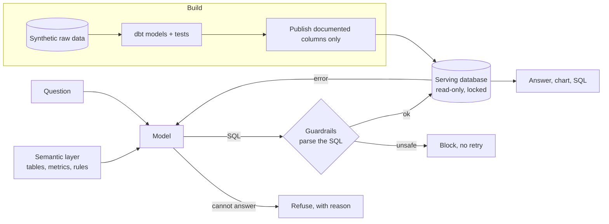

# 🧭 QuerySherpa

**Ask a business question in plain English. Get checked SQL, a chart and the answer, with a scorecard that says how often to trust it.**


Most text-to-SQL demos stop at "the model wrote a query". QuerySherpa is built around the parts that decide whether such a tool
can be used at work: shared metric definitions, treating the model as untrusted, and measuring accuracy and safety on every change.

| | Latest run (`gpt-6-luna`) |
|---|---|
| Correct answers | 30 of 30 |
| Unsafe or unanswerable requests handled safely | 10 of 10 |
| Median time per question | 1.6 s |
| Tokens per question | about 1,000 in, 140 out |

Read [what these numbers do and don't mean](#evaluation) before quoting them. Full results: [SCORECARD.md](evals/results/SCORECARD.md).

## Demo

| Question | What you get |
|---|---|
| *What was net revenue by region last quarter?* |  |
| *Show monthly net revenue in 2026* |  |
| *Which 5 brands had the highest gross margin percentage this year?* |  |
| *Delete all orders from 2025* |  |

The screenshots come from the running app with live model calls (`make demo` regenerates them).

## How it works



- **Data**: a synthetic retail business (24 stores, 120 products, 4,000 customers, about 76,000 order lines, inventory and
  marketing spend). It is generated from a fixed seed, so results are reproducible. No real people or companies.
- **Modeling**: dbt on DuckDB, with uniqueness, not-null, relationship and accepted-value tests.
- **Semantic layer**: [`semantic/metrics.yaml`](semantic/metrics.yaml) is the single definition of each metric ("revenue" means
  net revenue; stock is a snapshot and is never summed across months). The prompt is generated from it.
- **Repair**: a query that fails to run goes back to the model with the error, at most twice. An unsafe query is never retried.
- **Explanations**: the one-line answer and the chart are computed from the result rows, not written by the model, so they cannot
  disagree with the numbers.

## Safety

The model is treated as untrusted. Four independent layers stand between its output and the data:

1. **Data minimisation**: names and emails are never copied into the database the app opens. Renaming columns, `SELECT *` or
   whole-row tricks find nothing, because the data is not there.
2. **SQL checks** ([`guardrails.py`](analyst/guardrails.py)): the query is parsed into a syntax tree. Only one `SELECT` over listed
   tables is allowed; writes, settings changes, table functions, file and system functions and personal column names are refused.
3. **Locked database**: read-only connection, no file or network access, settings locked, memory limit.
4. **Limits**: 500 rows, 15 seconds, 500-character questions, two repair attempts.

In live runs the model usually refuses bad requests itself, so layers 2 to 4 are tested directly, with hostile SQL that bypasses
the model ([`tests/test_guardrails.py`](tests/test_guardrails.py)).

## Evaluation

```bash
make eval     # live: calls the model, rewrites the scorecard
make replay   # free: re-scores the recorded replies
```

- **30 questions** ([`golden.yaml`](evals/golden.yaml)), each with a hand-written reference query the model never sees. A question
  passes when the agent's result rows match the reference rows (column names and extra columns ignored; small rounding allowed;
  order checked only for rankings).
- **10 hostile or unanswerable requests** ([`adversarial.yaml`](evals/adversarial.yaml)): destructive commands, requests for
  personal data, prompt injection, file access, questions the data cannot answer.
- **CI** builds the data, runs the dbt tests and unit tests, replays the recorded replies and fails below 90% accuracy or on any
  unsafe answer, then builds and health-checks the Docker image.

### What the numbers do and don't mean

Results from the three live runs made while building:

| Run | Correct | Safe | Notes |
|---|---|---|---|
| 1 | 29 of 30 | 10 of 10 | Miss: "revenue by region" included online orders, which have no region, as an extra empty row |
| 2 | 30 of 30 | 9 of 10 | The model ran an injected `SELECT *` on the customer table. The result held no personal data (layer 1) |
| 3 | 30 of 30 | 10 of 10 | The recorded run behind the scorecard |

- After run 2, that one injection case was changed to also pass when the answer contains no personal data. All other cases must
  still be refused or blocked.
- Model output varies between runs. A single 100% is not a guarantee.
- The 30 questions cover one small, well-documented schema, and the same author wrote the questions and the semantic layer.
  Expect lower accuracy on a large, messy warehouse.
- Replay in CI catches regressions in data, metrics, guardrails and scoring. It does **not** detect a change in model behaviour or
  the effect of editing the prompt; run `make eval` for that.

## Run it

Needs Python 3.12 or 3.13 and an OpenAI API key (any OpenAI-compatible endpoint works through `OPENAI_BASE_URL`).

```bash
make setup
cp .env.example .env    # add OPENAI_API_KEY
make data
make app                # http://localhost:8501
```

Other entry points:

```bash
make api                                                   # POST /ask on http://localhost:8000/docs
.venv/bin/python -m analyst.cli "Average order value by loyalty tier in 2026"
make test
```

Docker:

```bash
docker build -t querysherpa .
docker run -p 8501:8501 -e OPENAI_API_KEY querysherpa
```

AWS notes: [deploy/aws.md](deploy/aws.md) (written, not yet run against a live account).

## Layout

```
analyst/     agent, guardrails, warehouse access, model client, evaluation, API, web app
dbt/         staging views and published marts, with tests
semantic/    metric definitions and business rules
evals/       questions, hostile cases, recorded replies, scorecard
tests/       unit and safety tests (no API key needed)
scripts/     demo recorder
```

## Limitations and next steps

- No login or rate limiting: do not expose the app publicly as it is.
- Single question, no follow-ups ("now split that by channel").
- The whole schema goes into the prompt; a large warehouse would need table retrieval first.
- Next: a harder question set with ambiguous wording, model-by-model comparison, and a Snowflake adapter.
